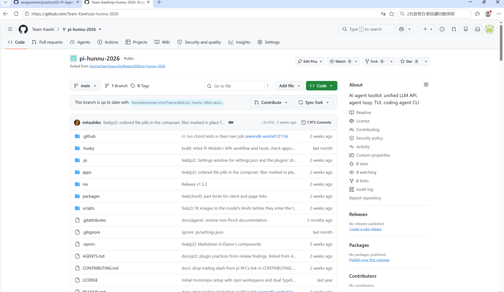
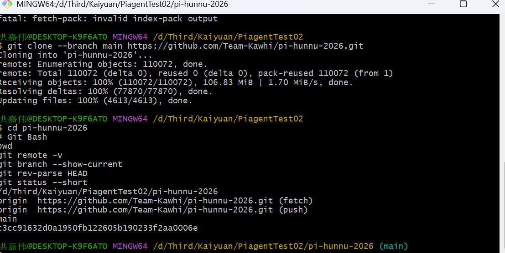
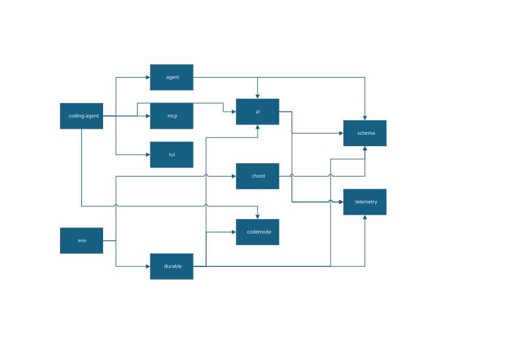

# 实践2：组织建仓与Pi-Agent源码阅读
姓名拼音：hongjiawei

## 1. 源码获取
1. 
2. 
3. Clone地址：`https://github.com/Team-Kawhi/pi-hunnu-2026`
> 记录本次commit哈希：c3cc91632d0a1950fb122605b190233f2aa0006e

## 2. 模块分析表
> 本人重点分析模块：agent、coding-agent

| 子文件夹 | 主要功能 | build 执行 / 生成 | 直接内部依赖 | 依据 |
| ---- | ---- | ---- | ---- | ---- |
| telemetry | 厂商中立遥测契约：TelemetryContext/Span、NOOP、跨进程传播、metric schema、内存参考实现；无 exporter、无全局状态 | tsc -p tsconfig.build.json → dist/ | 无 | package.json:19、src/{index,memory,metrics,noop}.ts |
| schema | 无 eval 的 JSON Schema（2020-12/7）：builder + 编译成闭包的校验器、coerce、explain、formats | tsc → dist/（含 dist/formats/） | 无 | package.json:23、src/{builders,compiler,validator}.ts |
| chord | 跨进程对象运行时：contract/facet/host、documents+SQLite store、links、plugins(esbuild 热重载)、HTTP、workers、web/tui/react surface | tsc → dist/（30+ 个 exports 子路径对应子目录） | schema、telemetry | package.json:151,172；src 内 import |
| tui | 终端 UI 库：差分渲染、CSI 2026 同步输出、组件、键位补全、内联图片 | tsc → dist/；另有 build:native:* 编译 prebuilds（默认 build 不含） | 无 | package.json:9,11-13、native/ |
| codemode | QuickJS-WASM 沙箱执行模型写的 JS，唯一能力是调注入的 tools；Node worker / Cloudflare portable 两套宿主 | tsc → dist/（含 runtime/worker.js） | 无 | package.json:31,60（deps 仅 quickjs-wasi）、README.md:9 |
| mcp | 独立 MCP 客户端：传输无关 McpClient + stdio/HTTP/Pipe/内存传输 + oauth | tsc → dist/ | 无 | package.json:31,57（deps 仅 cross-spawn）、README.md:5 |
| ai | 统一 LLM API：provider 集合、模型目录、auth/OAuth、tool calling、图像、遥测、pi-ai CLI | ① generate-models（联网抓 models.dev/OpenRouter/NVIDIA 等，重写 models.generated.ts、src/providers/data/）② build:offline：check:model-data + tsc + 拷 src/providers/data → dist/providers | schema、telemetry | package.json:72,76-79、catalog/sources/index.ts:29-92 |
| durable | 持久 agent harness：turn/tool call 先落盘再展示、崩溃后续跑重试；storage、tools、codemode、ExecutionEnv 接口 | tsc → dist/；paths 指向 ../chord/dist、../ai/dist | chord、ai、codemode、schema、telemetry | package.json:133,166、tsconfig.build.json:5-15 |
| env | 远程执行环境：Rust daemon（daemon/）+ RemoteExecutionEnv/SSH，工具跑远端、存储留本地 | tsc → dist/；paths 指向 ../chord/dist、../durable/dist；另有 build:daemon(cargo，默认不含) | chord（仅 context）、durable | package.json:26,34,47、src/remote-env.ts:4-24 |
| agent | 通用有状态 agent 核心：Agent + loop、transport 抽象、状态管理、事件流；无 CLI/UI | tsc → dist/；paths 指向 ../ai/dist | ai、schema | package.json:21,25、tsconfig.build.json:5-8 |
| coding-agent | Pi CLI 编码 agent（bin: pi）：TUI/print/RPC 模式、内置工具、MCP、codemode 工具、主题与资产 | ① tsc → dist/ + chmod cli.js/rpc-entry.js + copy-assets ② esbuild → dist/bundle/（cli、chunks、lazy OAuth、codemode-worker） | agent、ai、codemode、mcp、tui | package.json:33-34,43、build-coding-agent-bundle.mjs:84,140-152 |

## 3. 模块依赖关系图

图源文件：[pi-module-deps.vsdx](./assets/pi-module-deps.vsdx)

层级划分：
1. 入口层：coding-agent（CLI主程序入口）
2. 组装层：agent（智能体整合封装）
3. 能力调度层：chord、ai、mcp、codemode、tui、durable、env
4. 底层基础层：schema、telemetry（公共类型、遥测埋点）
箭头含义：使用方 → 被依赖方；实线代表运行时直接依赖

## 4. 问题回答
## Q1 根/子模块 npm run build 各读什么、做什么？
- 根：读根 package.json:15 的 scripts.build——一条硬编码 shell 链 `cd packages/X && npm run build`，顺序固定、无拓扑推导；build:offline 只把 ai 换成 build:offline。根 tsconfig.json 是 noEmit + paths 指向 src，供 npm run check 用，不参与构建。
- 子模块：读本包 package.json 的 scripts.build + tsconfig.build.json（extends tsconfig.base.json：ES2024/Node16/declaration+sourceMap，rootDir:src、outDir:dist）。9 个包只做 tsc；特例：ai 先联网生成模型目录再 tsc 并拷数据；coding-agent 先 tsc+拷资产再用 esbuild 打 dist/bundle/。tui 的 native、env 的 cargo daemon 是独立脚本，不在默认 build。
- 前置：npm ci --ignore-scripts 建 workspace 符号链接（当前未装）。

## Q2 构建顺序与依赖的关系？相邻一定互相依赖吗？
- 关系：顺序是人工写死的拓扑可行序——每个包的内部依赖都排在它前面。原因是构建时解析兄弟包要读对方的 dist/*.d.ts（durable/tsconfig.build.json:5-15、coding-agent:5-12），颠倒会 TS2307。
- 相邻不一定依赖。10 个相邻对里只有 4 对有直接依赖（schema→chord、ai→durable、durable→env、agent→coding-agent）；其余 6 对（telemetry→schema、chord→tui、tui→codemode、codemode→mcp、mcp→ai、env→agent）互不依赖。
- 反向也不成立：coding-agent 依赖 ai，中间隔 6 个包。顺序是“可编译序”，不是“依赖相邻序”，也非分层序（L2 的 agent 排在 L3 的 env 之后）。

## Q3 一条 ≥3 模块的依赖路径及分工（env → durable → chord → schema）

| 模块 | 分工 |
| ---- | ---- |
| schema | “值合不合法”：JSON Schema 编译器，chord 用它校验 contract 与 documents 写入值 |
| chord | “状态存在哪、怎么跨进程”：contract/host、事务 documents + SQLite store、delta/watch/context 等持久化原语，不含 agent 语义 |
| durable | “一轮对话如何可持久可恢复”：turn/tool call 先提交到 chord documents 再展示，崩溃后续跑重试；并定义 ExecutionEnv 接口 |
| env | “操作在哪执行”：实现 durable 的 ExecutionEnv，经 SSH 启动 Rust daemon 在远端跑文件/命令；chord/context 只传取消与遥测 |

链上任一层契约变更都向下传导，故构建必须自底向上。

